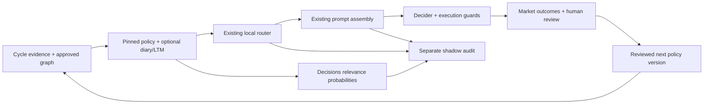

# Decisions shadow router

The OpenAI Decisions API is a second relevance scorer beside the existing local
policy router. Its question is **which optional guidelines add useful context to
this cycle?** The approved trading policy, its risk controls and the trade decision
remain with the existing assembly and Decider.

## What was reviewed

The October 28 review covered the live Policy Graph tab, `policy_graph/`,
`policy_router/`, the [RUSH repository](https://github.com/attdobi/RUSH),
[RUSH About](https://rush.attiladobi.com/#about), and the
[Judge Learning Loop](https://judge-learning-loop.adobi.chatgpt.site/) illustration.

RUSH keeps two loops separate: cheap continuous measurement and a slower learning
loop that changes a versioned policy through reviewed, bounded edits. The trader
uses market outcomes and human reviews as feedback, with delayed, noisy and
regime-dependent rewards. Realized return is not an unambiguous human answer key.
Routing is a fast selection step; changing a rule is a separate policy update.
The Judge Learning Loop website labels its animated numbers illustrative; they
are not measurements of either repository.

The review found:

- All 80 recent local-router runs were shadow comparisons. The latest hypothetical
  saving was 153 optional-context characters out of about 70,000 total prompt
  characters. This is a narrow reduction opportunity, not evidence of a large
  total-cost saving.
- Recent raw citation retention was 12/21. Every one of the nine excluded cited
  pairs referred to `DA.ltm.42`, the harmful macro-window veto retired earlier
  that day. Copying old decisions' citations is not the same as preserving useful
  policy. The UI now explains current retirement/conflict status separately from
  the historical count.
- The October 4 artifact's 97.4% proxy recall came from an older labeling protocol.
  Its similarity threshold used held-out citation pairs. New training fits that
  threshold on the outer training partition only and records its provenance.
  Inner leave-one-week-out still shares a training-defined label target; it is
  not independent forward validation. The old artifact has not been retrained or
  promoted by this change.
- The displayed 112% prompt ratio compared annotated served text with raw stored
  text. Both sides now use the same rendering; older logs are marked as using
  incompatible bases and do not display a reduction percentage.
- Guideline/path statistics pooled policy revisions while the page showed a
  selected version. They are now explicitly labeled history across versions and
  noncausal associations. Instrumentation gaps are distinguished from demonstrated
  retrieval misses. Win/loss counts consistently exclude the canonical $3
  break-even band.
- Hidden graph layers distorted the layout and clipped visible nodes. Forces and
  fit now use visible nodes. Router controls precede bounded historical tables.

## Execution



`decider_agent._policy_router_cycle` builds the shared cycle context once. When
enabled, it submits a background comparison, then runs the existing local router.
The comparison receives eligible diary entries and long-term memory rows. Standing
gates, lessons, identity, structure and code-owned rules are pinned. It uses the
existing high-recall selection algorithm and the same memory cap, currently 14.
Parent structure remains in the pinned graph. General rule routing and model
activation are outside this first rollout.

The Decisions response never enters `assembly_override`, `_router_memory_rows`
or trade actions. Its result type always reports `active=False` and exposes no
assembly override. It can run even when the local router is off. One hosted
comparison may be outstanding per process. The request and its SQL audit both
run off the trading thread; actual served IDs and the main `decider_inputs` row
are attached once known.

Each API request asks one predicate per candidate, up to 400. The predicate asks
for information relevant beyond the pinned policy, rather than ticker coincidence
or repetition of a standing rule. Candidate text is evidence; the opportunity
charter has precedence. Inputs contain regime, holding/watchlist/quarantine
tickers, news and event evidence, guideline text, and an as-of timestamp. They do
not contain future decisions, realized outcomes, account credentials or keys.

Answers must form a complete, correctly named and ordered set of finite
probabilities. Refusals, missing/duplicate answers, incompatible models and
timeouts produce an unavailable comparison, preserving the actual prompt.
Probabilities and expected recall are uncalibrated estimates for this workload,
not accuracy guarantees. The default request deadline is eight seconds, with no
automatic retries.

## API and cost

The [official Decisions guide](https://developers.openai.com/api/docs/guides/decisions)
describes batched predicate/choice/score questions. The
[create reference](https://developers.openai.com/api/reference/python/resources/decisions/methods/create)
currently supports `gpt-6-luna`. The installed OpenAI SDK is 2.6.0 and lacks the
Decisions resource, so the adapter uses the documented HTTPS endpoint through
`httpx`, an existing SDK dependency, with an injected transport for tests.

Standard short-context prices per million tokens are $0.10 uncached input,
$0.01 cached input and $0.125 for a 30-minute cache write. Decisions output is
free. Cached reads and writes are subsets of reported input tokens; neither is
added to input twice. Rates are recorded in the implementation's cost function;
regional/long-context premiums would need separate handling before using them.

The estimated per-request cost is:

```
((input - cached - writes) × 0.10 + cached × 0.01 + writes × 0.125) / 1,000,000
```

Shadow adds spend because it does not remove anything from the actual prompt.
For example, a $0.001 router request would need to remove 500 uncached Sol input
tokens just to offset its cost at $2/million; cached Sol inputs change that
comparison. Measure actual total cost and decision quality before claiming a win.

The six October 28 Luna summarizer calls averaged $0.001782 each; their summary
stamps and API usage records matched. The first Sol decision cycle cost $0.085089:
$0.073656 main decision, $0.010596 citation repair and $0.000837 extraction. The
earlier $0.061032 cycle used Terra. One Sol cycle does not establish its average.
Ordinary Chat cost estimates still omit caching details; Decisions has its own
cache-aware ledger.

## Audit and evaluation

`policy_router_comparisons` records provider/model, policy/question/request hashes,
per-node estimates and choices, actual served IDs, local-router choices, latency,
usage and endpoint-specific estimated cost. It stores hashes and identifiers,
not credentials or complete request/response bodies. `source_kind=live|replay`
and `source_input_id` keep saved-cycle probes identifiable. A request is one
billable call regardless of its number of questions. Failed/refused calls retain
known usage; uncertain cost is null with an explicit known subtotal.

The Policy Graph Router panel shows these comparisons. `/api/cost-usage` includes
their recorded costs exactly once under `PolicyRouterDecisions`, independently
of Chat repricing. An incomplete cost total is shown as unknown.

Before an active provider is considered:

1. Collect forward comparisons under stable policy and question hashes. Keep
   replay probes separate and stratify by regime, held positions and event risk.
2. Human-review disagreements and randomly sampled agreements. Distinguish
   useful exceptions, redundant context and retired/contradictory instructions.
3. Set thresholds on training examples, then evaluate untouched later cases.
   Report omission rates, calibration, safety-rule retention, full prompt tokens,
   latency and total dollars. Citation retention is an auxiliary proxy.
4. Use bounded paired Decider replays to test behavior under each selected context.
   Report market outcomes separately; retrospective return alone cannot identify
   the router's causal effect. Any activation requires its own measured gate.

## Configuration and local verification

```dotenv
DAI_DECISIONS_ROUTER=off
DAI_DECISIONS_TIMEOUT_S=8
```

Only `off` and `shadow` are supported; `active` does not enable hosted routing.
The local rollout stays off pending explicit approval for sending saved/live cycle
context to OpenAI. No saved-cycle hosted probe has been run yet. After approval,
set `shadow` and restart the trader; restart the dashboard to load new server
code. No restart or trader invocation is needed to run the offline tests.

```bash
./dai/bin/python -m pytest -q tests/test_decisions_router.py tests/test_decisions_shadow_bridge.py tests/test_cost_usage_decisions.py
```
