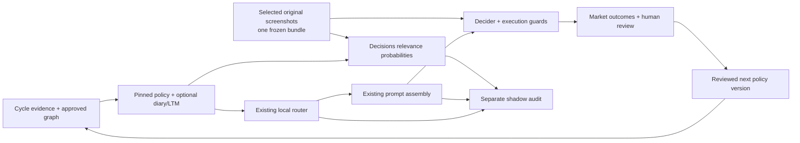

# Decisions shadow router

The OpenAI Decisions API is a second relevance scorer beside the existing local
policy router. Its question is **which optional guidelines add useful context to
this cycle?** The approved trading policy, its risk controls and the trade decision
remain with the existing assembly and Decider.

## Policy Router view and the October 29–November 5 evaluation

The third Policy Graph subtab, **Policy Router**, shows saved cycles in a history
list and slider. It follows evidence → proposed subgraph → actual Decider context,
with pinned/kept/skipped/actually-served IDs, relevance estimates, image coverage,
latency, usage and cost. Recorded-flow playback is a visualization of stored
results, not streaming internal reasoning. Visible-only 30-second refresh reads
the database; it never triggers an API call or changes routing.

GET `/api/policy-graph/router-cycles?limit=100` returns the trial and bounded
comparison list; GET `/api/policy-graph/router-cycles/<id>` returns one same-config
trace. Context is restricted to ticker lists, regime, counts, timestamps and image
availability. Cash, account IDs, raw prompts, replies and pixels are excluded.
The browser opens a selected guideline in its recorded policy version. Mutable
long-term memory inspection retains the existing graph's historical limitations.

Trial `365b75fca9704cd7b053de24d6f9429d` for config `9ea09b9as` starts at
`2026-10-29T17:40:18.639327+00:00` and ends at
`2026-11-05T17:40:18.639327+00:00`, after input watermark 154. The Pacific wall
clock changes from 10:40 AM to 9:40 AM because DST ends during this 168-hour window.
New native live comparisons count toward the evaluation; earlier live rows and
replay probes stay visible separately. An idempotent start cannot extend the
week. Concurrent first starts are serialized per configuration.

The current trader already produced live comparison 5 for input154: 60 pinned
nodes, eight kept optional memories, none skipped, twelve screenshots, 42,231
router input tokens and 7,502 ms latency, at $0.00521925. Its matched proposed text
input was unchanged at 19,772 tokens, so estimated net input savings were negative
by the router fee. This one cycle establishes functioning collection, not savings
or preserved trading quality. No new observer or trader restart was necessary.

`shadow_trial.py` persists the evaluation window and reports native calls without
pretending an old cached process can be retroactively controlled. Optional
reservation helpers provide atomic deduplication, expiry and finite spend bounds
for explicitly integrated callers; they are not an enforced kill switch on the
already-running native process. Unknown fees remain unknown. The evaluation
cohort ends at the deadline while regular shadow mode remains subject to review;
there is no automatic active-routing transition.

A daily thread heartbeat stays quiet before the deadline unless collection
requires attention, then reports cycle coverage, failures, router overhead,
matched savings estimates and available quality evidence. It makes no paid probe,
policy change, trader restart or order. A week of relevance selections alone does
not prove unchanged decision quality: matched full-versus-routed decisions and
later independent outcomes are still required. Pending horizons stay pending.

## October 29: shared original screenshot context

The router and trading Decider now receive the same frozen screenshot bundle from
the selected summary rows. Six sources normally supply two views each, or 12 PNG
originals; the inspected October 29 cycle used 1920 × 993 images. The Decider also
keeps the summary text. This implements direct visual context rather than relying
only on an extra summarizer description.

`cycle_images.freeze_summary_images` validates local PNGs referenced by those rows,
their agent/source-run/config scope, canonical screenshot-root paths and size
bounds. It freezes the bytes before the calls and assigns image IDs such as I01,
SHA-256, source/summary/run identifiers, dimensions and coverage/omission metadata.
It does not glob a latest directory, fetch a remote image or substitute another
cycle. Public manifests omit file paths and pixels. Screenshot files remain local
and ignored by Git.

Images appear once in Decisions' shared `input` as captioned `input_image` parts,
not once per guideline question. `detail: high` is explicit; the original PNG
bytes are unchanged, while provider preprocessing may resize them. The existing
400,000-character text guard remains separate from bounded image payload limits.
The model still returns per-guideline relevance probabilities and the selector
still returns pinned/selected/skipped IDs. No visual cue activates a provider or
changes a trading control.

`DAI_ROUTER_IMAGES` and `DAI_DECIDER_IMAGES` independently default to `1`; set either
to `0` to omit images from that destination. `DAI_DECISIONS_ROUTER=shadow` remains
the hosted-router mode switch. Neither image flag enables active routing. Missing
or rejected images remain explicit coverage limitations; they are not an invented
bearish signal. The router may still make its relevance comparison from supplied
text, and the Decider keeps its existing independent entry/exit requirements.

The visual policy records image choice, captions, visible expressions/scenes and
headline-image contrasts as observations and editorial-framing hypotheses. It does
not infer a person's genuine emotion, identity or intent from appearance. Photo
age/stock status requires supplied evidence; repeated pixels establish reuse, not
manipulation. Visual tone alone never grants a BUY/SELL, sizing or earnings-policy
exception. Learning these associations remains a reviewed experiment, not an
already validated source of alpha. See [visual review](LEARNING_MAP.md).

### October 29 provider verification

The user-authorized validation used saved input **153** and its exact six summary
rows/twelve original PNGs. It evaluated current approved **Decider v61** against
that saved v60 market context; this is a replay probe, not an exact historical
prompt recreation. Comparisons **3** and **4** are scoped to config `9ea09b9as`.

| Request | Input tokens | 30-minute cache-write tokens | Cost at standard rates | Latency |
|---|---:|---:|---:|---:|
| Text only | 16,169 | 13,784 | $0.00196150 | 1,490 ms |
| Same context plus 12 originals | 41,151 | 38,766 | $0.00508425 | 2,930 ms |

There were no cache reads or billed output tokens. The **24,982-token** and
**$0.00312275** difference includes the image manifest/captions as well as vision
input; it is not an isolated image-token tariff. Both kept seven of eight
optional memories beside 60 pinned nodes, but they skipped different memories.
That demonstrates functioning image input and selection, not superior selection
quality. Each request ran once without a retry.

A separate nontrading `gpt-6.1-sol` vision check received the same twelve images,
recognized their source labels and returned a limitation of photo-based price
inference. It reported **28,382 input**, **265 output**, **0 cached input** and
**0 reasoning tokens**, costing **$0.059414** at the standard local tariff.
`VisionValidationAgent` records that usage separately. This short low-reasoning
validation is not the full high-reasoning trading Decider, nor an exact estimate
of its incremental image cost. No orders, full trading pipeline or trader restart
were invoked. Hosted routing remains shadow with zero realized savings.

## What was reviewed

The October 28 review covered the live Policy Graph tab, `policy_graph/`,
`policy_router/`, the [RUSH repository](https://github.com/attdobi/RUSH),
[RUSH About](https://rush.attiladobi.com/#about), and the
[Judge Learning Loop](https://judge-learning-loop.adobi.chatgpt.site/) illustration.

RUSH keeps two loops separate: cheap continuous measurement and a slower learning
loop that changes a versioned policy through reviewed, bounded edits. The trader
uses market outcomes and human reviews as feedback, with delayed, noisy and
regime-dependent rewards. Realized return is not an unambiguous human answer key.
Routing is a fast selection step; changing a rule is a separate policy update.
The Judge Learning Loop website labels its animated numbers illustrative; they
are not measurements of either repository.

The review found:

- All 80 recent local-router runs were shadow comparisons. The latest hypothetical
  saving was 153 optional-context characters out of about 70,000 total prompt
  characters. This is a narrow reduction opportunity, not evidence of a large
  total-cost saving.
- Recent raw citation retention was 12/21. Every one of the nine excluded cited
  pairs referred to `DA.ltm.42`, the harmful macro-window veto retired earlier
  that day. Copying old decisions' citations is not the same as preserving useful
  policy. The UI now explains current retirement/conflict status separately from
  the historical count.
- The October 4 artifact's 97.4% proxy recall came from an older labeling protocol.
  Its similarity threshold used held-out citation pairs. New training fits that
  threshold on the outer training partition only and records its provenance.
  Inner leave-one-week-out still shares a training-defined label target; it is
  not independent forward validation. The old artifact has not been retrained or
  promoted by this change.
- The displayed 112% prompt ratio compared annotated served text with raw stored
  text. Both sides now use the same rendering; older logs are marked as using
  incompatible bases and do not display a reduction percentage.
- Guideline/path statistics pooled policy revisions while the page showed a
  selected version. They are now explicitly labeled history across versions and
  noncausal associations. Instrumentation gaps are distinguished from demonstrated
  retrieval misses. Win/loss counts consistently exclude the canonical $3
  break-even band.
- Hidden graph layers distorted the layout and clipped visible nodes. Forces and
  fit now use visible nodes. Router controls precede bounded historical tables.

## Execution



`decider_agent._policy_router_cycle` builds the shared cycle context once. When
enabled, it submits a background comparison, then runs the existing local router.
The comparison receives eligible diary entries and long-term memory rows. Standing
gates, lessons, identity, structure and code-owned rules are pinned. It uses the
existing high-recall selection algorithm and the same memory cap, currently 14.
Parent structure remains in the pinned graph. General rule routing and model
activation are outside this first rollout.

The Decisions response never enters `assembly_override`, `_router_memory_rows`
or trade actions. Its result type always reports `active=False` and exposes no
assembly override. It can run even when the local router is off. One hosted
comparison may be outstanding per process. The request and its SQL audit both
run off the trading thread; actual served IDs and the main `decider_inputs` row
are attached once known.

Each API request asks one predicate per candidate, up to 400. The predicate asks
for information relevant beyond the pinned policy, rather than ticker coincidence
or repetition of a standing rule. Candidate text is evidence; the opportunity
charter has precedence. Inputs contain regime, holding/watchlist/quarantine
tickers, news and event evidence, guideline text, and an as-of timestamp. They do
not contain future decisions, realized outcomes, account credentials or keys.
Current image-enabled requests also contain the selected screenshot pixels and
their source/image-ID metadata. The public audit stores only their manifest, not
the base64 payload. October 28 text-only probes below remain historical records.

Answers must form a complete, correctly named and ordered set of finite
probabilities. Refusals, missing/duplicate answers, incompatible models and
timeouts produce an unavailable comparison, preserving the actual prompt.
Probabilities and expected recall are uncalibrated estimates for this workload,
not accuracy guarantees. The default request deadline is eight seconds, with no
automatic retries.

## API and cost

The [official Decisions guide](https://developers.openai.com/api/docs/guides/decisions)
describes batched predicate/choice/score questions. The
[create reference](https://developers.openai.com/api/reference/python/resources/decisions/methods/create)
currently supports `gpt-6-luna`. The installed OpenAI SDK is 2.6.0 and lacks the
Decisions resource, so the adapter uses the documented HTTPS endpoint through
`httpx`, an existing SDK dependency, with an injected transport for tests.

Standard short-context prices per million tokens are $0.10 uncached input,
$0.01 cached input and $0.125 for a 30-minute cache write. Decisions output is
free. Cached reads and writes are subsets of reported input tokens; neither is
added to input twice. Rates are recorded in the implementation's cost function;
all input/cache rates double above 272,000 input tokens. Other billing adjustments,
such as regional premiums, are outside this standard-rate estimate.

The estimated per-request cost is:

```
((input - cached - writes) × 0.10 + cached × 0.01 + writes × 0.125) / 1,000,000
```

Shadow adds spend because it does not remove anything from the actual prompt.
For example, a $0.001 router request would need to remove 500 uncached Sol input
tokens just to offset its cost at $2/million; cached Sol inputs change that
comparison. Measure actual total cost and decision quality before claiming a win.

### Matched text economics and shared image context

New live comparisons freeze the graph, cycle context, health annotations, memory
rows/order, exact system/user text, citation index and client reasoning guidance
before the Decider call. The audit worker renders three matched inputs: actually
served, all optional candidates, and the Decisions-selected proposal. The actual
reconstruction must match byte for byte or the economics report is unavailable.
Only counts/hashes, selected/skipped IDs and a public image manifest are added to
`comparison_json`; raw prompts and screenshot pixels are not added to this ledger.

`policy_router/economics.py` uses a verified, already-cached `o200k_base` vocabulary
through tiktoken. It never downloads a tokenizer during a cycle; without that
cache, its UTF-8/4 fallback is explicitly labeled. These are full-text estimates,
not measured provider framing or a claim about an undocumented model tokenizer.
The configured primary Decider model is recorded separately from provider usage.
With images, `token_scope=text_only`: the same frozen images remain on every
counterfactual side, and their input-token count is unknown to the local estimator.
`text_input_reduction_pct` describes text only; the total-input percentage stays
null. The estimator does not convert PNG/base64 length into billable vision tokens
or assume a published profile for an undocumented model variant. Provider-reported
input usage includes image processing, whereas these local counts do not.

Potential gross savings = estimated removed **input** tokens × the Decider's
uncached input rate. Potential net input savings subtract the router's recorded
API cost, including its image input, and may be negative. The shared Decider images
are not counted as removed context. No output/reasoning reduction is assumed. Cache-
adjusted dollars stay unknown; a cache-heavy Decider request can save less than
the uncached estimate. Shadow realized savings are always **$0** and its router
fee is incremental spend. Historical comparisons without a frozen snapshot stay
unavailable; current policy is never substituted into an old cost measurement.

The Router panel shows these estimates and complete JSON ID lists for pinned,
selected, skipped and actually served optional nodes. A selection probability is
relevance, not the chance that a trade wins. Theme filters never change routing.

### October 28 verification

Local Postgres initially contained only the earlier saved-input probe, with no
forward live Decisions rows. The running process predated the new instrumentation;
the local `.env` setting alone did not reload its imported code. Both the local
router's latest logged run and the hosted adapter remain **shadow**. No provider
activation or live-trader restart is part of this visualization/measurement change.

A second single paid probe used the six summaries from source input **150** and
the current approved **v60** policy. This deliberately combines saved v59 market
context with current policy; it is labeled replay and is not an exact historical
prompt recreation. It returned a valid complete predicate/selection result in
**1,376 ms**, keeping **7 of 8 optional memories** beside **58 pinned nodes**.
It reported **14,823 input tokens**, including **12,886 30-minute cache-write
tokens**, no cache reads, and an estimated fee of **$0.00180445**. No trading
Decider call or order was made. The earlier probe cost $0.002996075.

At the configured Sol uncached input rate of $2/million, the second router fee
requires removing at least **903 input tokens** just to break even. It omitted
only one short memory, so a small optional pool should not be assumed economical.
Its full-prompt economics remain unavailable because no contemporaneous production
capture exists for this mixed-policy probe. Future instrumented live comparisons
will measure matched text; neither probe establishes quality preservation.

At the October 28 check, the prospective opportunity ledger had **zero rows**, so paper recall,
FPR and their uncertainty are unknown, not zero or perfect. Closed-trade P&L and
win-rate associations still exist; they are not the counterfactual quality loss
from excluding a guideline. Live capture and its scheduled outcome maintenance
require the existing trader to load the new code. Never start a second trader to
collect these measurements.

The six October 28 Luna summarizer calls averaged $0.001782 each; their summary
stamps and API usage records matched. The first Sol decision cycle cost $0.085089:
$0.073656 main decision, $0.010596 citation repair and $0.000837 extraction. The
earlier $0.061032 cycle used Terra. One Sol cycle does not establish its average.
Ordinary Chat cost estimates still omit caching details; Decisions has its own
cache-aware ledger.

## Audit and evaluation

`policy_router_comparisons` records provider/model, policy/question/request hashes,
per-node estimates and choices, actual served IDs, local-router choices, latency,
usage and endpoint-specific estimated cost. It stores hashes and identifiers,
not credentials or complete request/response bodies. `source_kind=live|replay`
and `source_input_id` keep saved-cycle probes identifiable. A request is one
billable call regardless of its number of questions. Failed/refused calls retain
known usage; uncertain cost is null with an explicit known subtotal.

The Policy Graph Router panel shows these comparisons. `/api/cost-usage` includes
their recorded costs exactly once under `PolicyRouterDecisions`, independently
of Chat repricing. An incomplete cost total is shown as unknown.

Before an active provider is considered:

1. Collect forward comparisons under stable policy and question hashes. Keep
   replay probes separate and stratify by regime, held positions and event risk.
2. Human-review disagreements and randomly sampled agreements. Distinguish
   useful exceptions, redundant context and retired/contradictory instructions.
3. Set thresholds on training examples, then evaluate untouched later cases.
   Report omission rates, calibration, safety-rule retention, full prompt tokens,
   latency and total dollars. Citation retention is an auxiliary proxy.
4. Use bounded paired Decider replays to test behavior under each selected context.
   Report market outcomes separately; retrospective return alone cannot identify
   the router's causal effect. Any activation requires its own measured gate.

## Configuration and local verification

```dotenv
DAI_DECISIONS_ROUTER=shadow
DAI_DECISIONS_TIMEOUT_S=8
DAI_ROUTER_IMAGES=1
DAI_DECIDER_IMAGES=1
```

Only `off` and `shadow` are supported; `active` does not enable hosted routing.
The default remains `off`. After explicit owner approval on October 28, the local
configuration was set to `shadow`. Restart the trader to load this setting and the
new code; restart the dashboard to load the new server code. Existing running
processes were not restarted by the probe. No restart or trader invocation is
needed to run the offline tests.

The first approved saved-cycle probe succeeded and is recorded as comparison 1,
`source_kind=replay`, linked to exact Decider input 148. It scored 31 optional
nodes against 55 pinned nodes and selected 17, in 1,326 ms. Reported usage was
25,473 input tokens: 7,522 uncached and 17,951 written to the 30-minute cache,
with no cache reads or output tokens. Its endpoint-specific estimated cost was
**$0.002996075**, about $0.003. This cold-cache probe measures request mechanics
and relevance estimates; it does not establish forward quality or actual prompt
savings. The trading prompt and trade decisions were unchanged.

```bash
./dai/bin/python -m pytest -q tests/test_decisions_router.py tests/test_decisions_shadow_bridge.py tests/test_cost_usage_decisions.py
```
